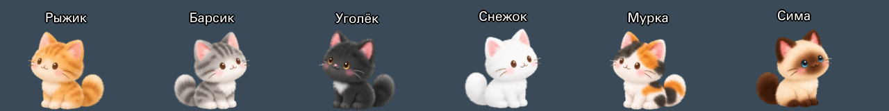

# Котята из чата — оверлей для OBS

Пушистые котята гуляют по нижнему краю экрана. Кто пишет в чат Twitch, получает своего котёнка с ником.



- Котёнок появляется из коробки на первое сообщение зрителя. Если зритель молчит 2 минуты, котёнок запрыгивает обратно в коробку и уходит.
- Котята гуляют, стоят, сидят, моргают, умываются, потягиваются, мяукают, лежат и спят.
- 6 окрасов: рыжий, полосатый, чёрный, белый, трёхцветный, сиамский. Окрас выбирается по нику, у одного зрителя он всегда один и тот же.
- Сообщение зрителя на 6 секунд всплывает облачком над котёнком. Облачко не показывается для длинных сообщений, команд `!…`, ссылок, сообщений из одних смайлов и сообщений с запретными словами (списки `BAD_RU` / `BAD_EN` в начале скрипта).
- Известные боты (StreamElements, Nightbot и другие) котят не получают.
- Чат читается анонимно, только на чтение. Ни токенов, ни авторизации не нужно.
- Одна HTML-страница без сборки и зависимостей.

## Установка в OBS

### Вариант 1: с компьютера

1. Скачайте репозиторий: **Code → Download ZIP** и распакуйте, например, в `C:\` — получится папка `C:\cats-overlay-main`.
2. В OBS: **Источники → + → Браузер**.
3. Галочку **«Локальный файл»** НЕ ставить: с ней OBS не даёт дописать параметры. В **URL** впишите путь через `file:///`, прямыми слэшами:

   ```
   file:///C:/cats-overlay-main/overlay/index.html?channel=<ваш_ник_на_twitch>
   ```
4. **Ширина** = ширине сцены (например, `1920`), **высота** — `300`–`400`. Котята ходят по нижней границе источника, так что источник можно поставить куда угодно.
5. OK. Напишите что-нибудь в чат: через пару секунд из коробки выпрыгнет котёнок.

Папку `sprites` нельзя отделять от `index.html`: она должна лежать рядом.

### Вариант 2: на своём сервере

Положите папку `overlay/` на любой веб-сервер (nginx, Caddy и т. п.) и укажите в OBS её адрес с `?channel=…` (галочку «Локальный файл» не ставить). Серверная часть не нужна, это статика.

## Параметры адреса

Параметры дописываются после `?` через `&`, например:
`…/overlay/?channel=mychannel&size=120&ignore=mybot`

| Параметр | По умолчанию | Что делает |
|---|---|---|
| `channel` | — (обязателен) | Ник канала Twitch. Можно несколько через запятую: `channel=one,two` |
| `size` | `150` | Размер котёнка в пикселях |
| `idle` | `120` | Через сколько секунд тишины котёнок уходит |
| `max` | `30` | Максимум котят на экране |
| `ignore` | — | Свои боты через запятую, им котят не давать: `ignore=mybot,otherbot` |
| `test` | — | `test=1`: показать по котёнку каждого окраса без чата, чтобы настроить источник |
| `bg` | прозрачный | Цвет фона без `#`, только для проверки в браузере: `bg=3a4a58` |

Параметры для отладки (с `test=1`):
- `pose=sit|stand|walk|lick|stretch|lie|sleep|meow`: зафиксировать позу;
- `say=привет`: облачко над котятами;
- `fx=in|out&ft=1.2`: стоп-кадр появления/ухода в коробку на заданной секунде; `fx=loop` — по кругу.

## Проверка в браузере

Откройте `overlay/index.html?test=1&bg=3a4a58` в Chrome. Если открываете с диска и спрайты не грузятся, запустите в папке репозитория простой сервер и откройте страницу через него:

```bash
python3 -m http.server 8000
```

Адрес: `http://localhost:8000/overlay/?test=1&bg=3a4a58`

## Как устроено

```
overlay/
  index.html              весь оверлей: чат, поведение, коробка, облачка
  sprites/fluffy_*.webp   лист котёнка 7×2 кадра по 320 px на каждый окрас
                          ряд 1: шаг ×6, стоит; ряд 2: сидит, жмурится, спит, умывается, тянется, лежит, мяукает
  sprites/box.webp        коробка: закрытая, открытая, передняя стенка (300×240)
tools/
  src/                    исходные картинки на зелёном фоне (#00FF00)
  mksheet.py              src/<окрас>_walk.png + src/<окрас>_pose.png → overlay/sprites/fluffy_<окрас>.webp
  mkbox.py                src/box.png → overlay/sprites/box.webp
  gencoat.sh              новый окрас через Codex CLI (ChatGPT): перекрашивает рыжие исходники
```

Картинки нарисованы нейросетью (ChatGPT image generation) и собраны в листы скриптами из `tools/`.

## Свой окрас

Нужны Python 3 и, для генерации, [Codex CLI](https://github.com/openai/codex) с входом через ChatGPT.

```bash
cd tools
python3 -m venv venv && . venv/bin/activate
pip install -r requirements.txt

# 1. Перекрасить рыжие исходники (можно и без Codex: перекрасьте src/ginger_*.png в любом редакторе,
#    не трогая зелёный фон, и сохраните как src/<окрас>_walk.png и src/<окрас>_pose.png)
./gencoat.sh grey "solid blue-grey (russian blue) fur, slightly lighter belly"

# 2. Собрать лист для оверлея
python3 mksheet.py grey
```

Затем добавьте окрас в массив `COATS` в `overlay/index.html` (имя для режима `test=1` задаётся в объекте с именами чуть ниже):

```js
var COATS=['ginger','tabby','black','white','calico','siamese','grey'];
```

Требования к исходникам: `*_walk.png` — 6 кадров шага (сетка 3×2), `*_pose.png` — 8 поз (сетка 4×2) в порядке: сидит, жмурится, спит, стоит, умывается, тянется, лежит, мяукает. Котёнок смотрит вправо, фон чисто зелёный `#00FF00`. `mksheet.py` сам снимает фон, находит кадры и ставит их на одну линию пола.

## Лицензия

MIT — см. [LICENSE](LICENSE).
